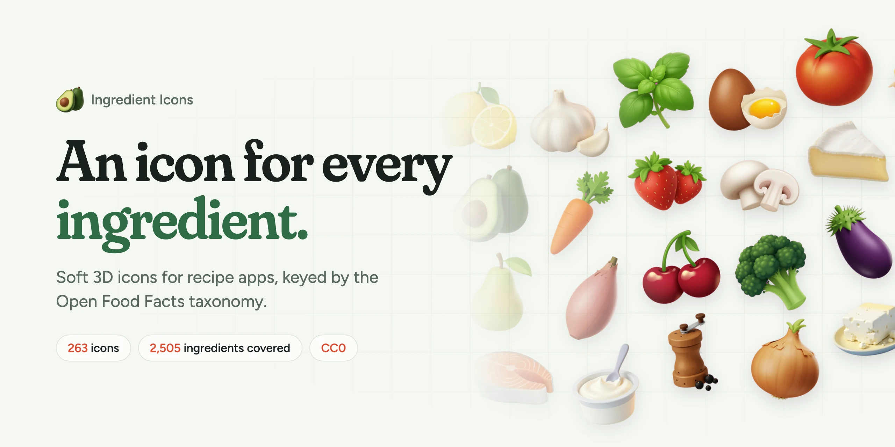
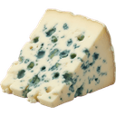
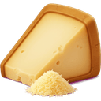

<p align="center">
  <a href="https://ingredient-icons.vercel.app">
    <picture>
      <source media="(prefers-color-scheme: dark)" srcset=".github/assets/banner-dark.webp">
      
    </picture>
  </a>
</p>

<p align="center">
  <b>428 soft 3D icons for recipe apps, one for every ingredient family, keyed by an open ingredient catalog.</b><br>
  Shallots, crème fraîche, salt and pepper each get their own, and anything else borrows its closest parent's.
</p>

<p align="center">
  <a href="https://www.npmjs.com/package/@ingredient-icons/core"></a>
  <a href="LICENSE-ICONS"></a>
  <a href="https://ingredient-icons.vercel.app/icons"></a>
  <a href="https://ingredient-icons.vercel.app"></a>
</p>

<p align="center">
  <a href="https://ingredient-icons.vercel.app"><b>Website</b></a> ·
  <a href="https://ingredient-icons.vercel.app/docs">Docs</a> ·
  <a href="https://ingredient-icons.vercel.app/icons">Browse the icons</a> ·
  <a href="https://github.com/EBf-Studio/ingredient-icons/issues/new">Request an icon</a>
</p>

## Emojis run out at the onion

There is no emoji for a shallot, and 🧂 has to stand in for salt and pepper. A recipe shows each ingredient as what it is.

| Emoji | Ingredient Icons |
| :---: | --- |
| 🧅 |      |
| 🧂 |      |
| 🧀 |      |

## Quick start

```sh
npm install @ingredient-icons/core
```

Pass the catalog id of an ingredient, get back an image URL:

```tsx
import { iconUrl } from "@ingredient-icons/core"

export function Ingredient({ id, quantity, name }) {
  return (
    <li>
      
      {quantity} {name}
    </li>
  )
}

<Ingredient id="cherry-tomato" quantity="250 g" name="cherry tomatoes" />
```

URLs point to the exact release you installed on jsDelivr, so icons never change under you. Pass `baseUrl` to serve them from your own CDN or app bundle. Works in React, React Native, Node, Bun, Deno and anything else that shows images, with TypeScript types included.

```ts
import { GENERIC_ID, iconUrl } from "@ingredient-icons/core"

iconUrl("shallot", { size: 256 })
// https://cdn.jsdelivr.net/npm/@ingredient-icons/core@<version>/icons/webp/256/shallot.webp

iconUrl("garam-masala")  // undefined: no icon of its own, see below for its family's
iconUrl("unicorn-steak") ?? iconUrl(GENERIC_ID)  // the generic icon, a cluster of fresh ingredients
```

`GENERIC_ID` (`"generic"`) is a reserved id, not a catalog one: the icon for an ingredient nothing places at all.

[React](https://ingredient-icons.vercel.app/docs/guides/react) · [React Native](https://ingredient-icons.vercel.app/docs/guides/react-native) · [Next.js](https://ingredient-icons.vercel.app/docs/guides/nextjs) · [Self-hosting](https://ingredient-icons.vercel.app/docs/guides/self-hosting) · [Without npm](https://ingredient-icons.vercel.app/docs/guides/without-npm) · [API reference](https://ingredient-icons.vercel.app/docs/reference/api)

## No icon of its own? It borrows its parent's

Ids come from an ingredient catalog of 1,227 catalog ingredients under 32 families, each with exactly one parent: smoked salt is a salt, and salt falls under the salts family. Every family has an icon, so walking up the parents always ends on one: that's how **428 icons cover all 1,259 catalog entries**. The catalog ships with every release as `catalog.json` (ids, parents, families, and names in six languages).

<p>
  <code>smoked-salt</code> →  <code>salt</code><br>
  <code>tomato-pulp</code> →  <code>tomato</code><br>
  <code>garam-masala</code> →  <code>spice-blends</code>
</p>

```ts
import snapshot from "@ingredient-icons/core/catalog.json"
import { GENERIC_ID, iconUrl, type Catalog } from "@ingredient-icons/core"

const catalog: Catalog = snapshot as Catalog

/** Its own icon, else its nearest ancestor's, its family's last, else the generic one. */
function iconFor(id: string): string {
  for (let at: string | undefined = id; at; at = catalog.entries[at]?.parent) {
    const url = iconUrl(at)
    if (url) return url
  }
  return iconUrl(GENERIC_ID)!
}
```

In plain Node or Deno, import the JSON with an import attribute: `with { type: "json" }`.

Try it with any ingredient [on the website](https://ingredient-icons.vercel.app).

## Sharp from a list row to a hero

| Format | Sizes | Where |
| --- | --- | --- |
| WebP | 64, 128, 256 px | npm package and `icons/webp/` |
| PNG | 64, 128, 256, 512 px | `icons/png/` in this repository |

128 px covers a 40 pt icon on a 3× screen; 256 px covers almost everything else. Names come from `catalog.json`, in French, English, Spanish, Italian, German and Portuguese.

## Without npm

The icons are plain files with a JSON manifest, ready for Swift, Kotlin, Python or anything else.

| Path | Content |
| --- | --- |
| `icons/png/{64,128,256,512}/` | Transparent PNG, the canonical format |
| `icons/webp/{64,128,256}/` | The same as WebP |
| `manifest.json` | Every icon by catalog id (plus `generic`, the icon for an ingredient nothing matches), the sizes and the path template |
| `catalog.json` | Every catalog ingredient and family by id: its parent, its family, and its names and synonyms per language |

File names are catalog ids: `shallot` → `icons/png/256/shallot.png`. To find an icon, look the id up in `manifest.json`; when it has none, walk up its parents in `catalog.json`:

```ts
import manifest from "./manifest.json"
import catalog from "./catalog.json"

const icons = new Set<string>(manifest.icons)
const entries: Record<string, { parent?: string; names: object }> = catalog.entries

function iconFor(id: string): string {
  for (let at: string | undefined = id; at; at = entries[at]?.parent) {
    if (icons.has(at)) return at
  }
  return "generic"
}
```

The repository grows with every batch: `git clone --depth 1` if you only need the icons.

## Missing an ingredient?

New icons ship in batches. [Open an issue](https://github.com/EBf-Studio/ingredient-icons/issues/new) with the catalog id (`acorn-squash`) or the name of the ingredient, and it goes on the list. An ingredient the catalog lacks is added to it first.

## Development

The icons are built from private sources (raw images and prompts), checked out next to this repository (or set `INGREDIENT_ICONS_SOURCES`):

```sh
bun install
bun run batch start        # the sources' branch of this branch's name (a batch lives on one name in both)
bun run catalog   # rewrites catalog.json from Marmalade's ingredient catalog (see scripts/catalog.ts)
bun run impact acorn-squash # what new icons would change in the fallbacks, before generating them
bun run subject acorn-squash "…" # adds or replaces a subject in the sources' subjects.json
bun run preview    # contact sheets and checks for the candidates in the sources' inbox/
bun run pick honey=2       # moves a chosen candidate to the sources' raw/
bun run batch save "…"     # commits and pushes the sources' branch
bun run build      # cut-out, every size and format, manifest.json, .out/review.html (only changed raws; --force for all, --prune to remove icons)
bun run sheet      # the review sheet of the icons that differ from origin/main, for the pull request
bun run batch finish       # once the pull request is approved: the sources' branch into main, then the pull request merged
bun run check      # types, tests, files against the manifest, ids against the catalog, an icon for every family
bun run docs       # the website (apps/docs) on http://localhost:3000
```

`build.lock.json` records the raw each icon was built from, so a build only redoes the icons whose raw changed. A batch reaches `main` of either repository only once its icons are approved in the pull request, so `main` of the sources holds exactly the raws of the published icons. The whole process, from the list of ingredients to the merge, is in [`.claude/skills/ingredient-icons`](.claude/skills/ingredient-icons/SKILL.md).

`catalog.json` is a snapshot of the ingredient catalog [Marmalade](https://try-marmalade.com) maintains, which grows every week; `release` names the catalog release it comes from. Each pack release ships the snapshot of its day, and `bun run check` refuses an icon whose id left the catalog, or a family without an icon.

The website is a Fumadocs app in `apps/docs`: home page, documentation in `apps/docs/content/docs`, and a page per icon. It reads `manifest.json`, `catalog.json` and `icons/` from the repository, so a new batch shows up on the next deploy. On Vercel, set the project's root directory to `apps/docs`.

## Licenses

- Icons and `manifest.json`: [CC0 1.0](LICENSE-ICONS). Created with Grok. No attribution required, a link back is appreciated.
- `catalog.json`: [CC0 1.0](LICENSE-ICONS). Names from [Wikidata](https://www.wikidata.org) (CC0) or written by Marmalade.
- Code: [MIT](LICENSE).

See [NOTICE](NOTICE).

<p align="center">
  <br>
  <br>
  Made by <a href="https://try-marmalade.com">Marmalade</a>
</p>
