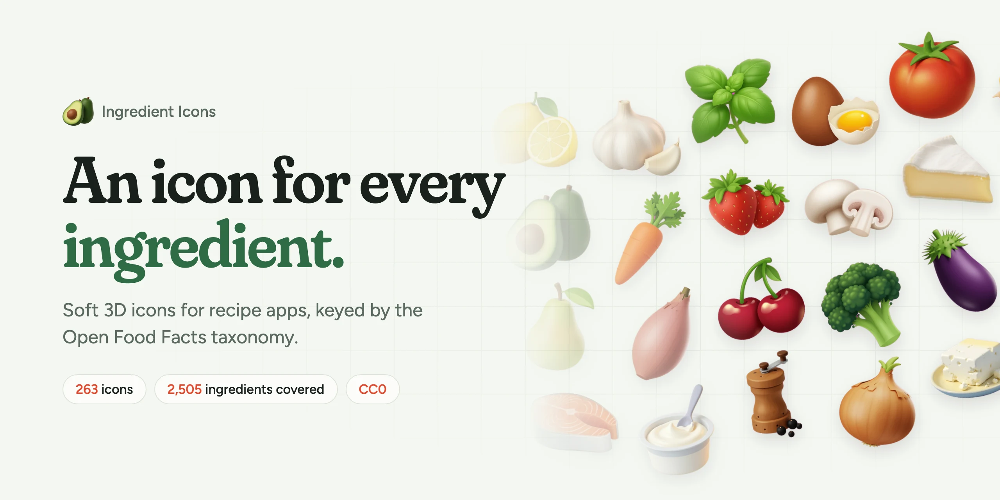
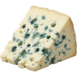
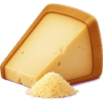

<p align="center">
  <a href="https://ingredient-icons.vercel.app">
    <picture>
      <source media="(prefers-color-scheme: dark)" srcset=".github/assets/banner-dark.webp">
      
    </picture>
  </a>
</p>

<p align="center">
  <b>263 soft 3D icons for recipe apps, keyed by the Open Food Facts taxonomy.</b><br>
  Shallots, crème fraîche, salt and pepper each get their own, and anything else borrows its closest parent's.
</p>

<p align="center">
  <a href="https://www.npmjs.com/package/@ingredient-icons/core"></a>
  <a href="LICENSE-ICONS"></a>
  <a href="https://ingredient-icons.vercel.app/icons"></a>
  <a href="https://ingredient-icons.vercel.app"></a>
</p>

<p align="center">
  <a href="https://ingredient-icons.vercel.app"><b>Website</b></a> ·
  <a href="https://ingredient-icons.vercel.app/docs">Docs</a> ·
  <a href="https://ingredient-icons.vercel.app/icons">Browse the icons</a> ·
  <a href="https://github.com/EBf-Studio/ingredient-icons/issues/new">Request an icon</a>
</p>

## Emojis run out at the onion

There is no emoji for a shallot, and 🧂 has to stand in for salt and pepper. A recipe shows each ingredient as what it is.

| Emoji | Ingredient Icons |
| :---: | --- |
| 🧅 |      |
| 🧂 |      |
| 🧀 |      |

## Quick start

```sh
npm install @ingredient-icons/core
```

Pass the Open Food Facts id your recipe already stores, get back an image URL:

```tsx
import { iconUrl } from "@ingredient-icons/core"

export function Ingredient({ id, quantity, name }) {
  return (
    <li>
      
      {quantity} {name}
    </li>
  )
}

<Ingredient id="en:cherry-tomato" quantity="250 g" name="cherry tomatoes" />
```

URLs point to the exact release you installed on jsDelivr, so icons never change under you. Pass `baseUrl` to serve them from your own CDN or app bundle. Works in React, React Native, Node, Bun, Deno and anything else that shows images, with TypeScript types included.

```ts
import { findIcon, iconName, iconUrl } from "@ingredient-icons/core"

iconUrl("en:shallot", { size: 256 })
// https://cdn.jsdelivr.net/npm/@ingredient-icons/core@<version>/icons/webp/256/en_shallot.webp

findIcon("en:cherry-tomato")  // { id: "en:tomato", file: "en_tomato", exact: false }
iconName("en:shallot", "fr")  // "échalote"
findIcon("en:unicorn-steak")  // undefined: show your own placeholder
```

[React](https://ingredient-icons.vercel.app/docs/guides/react) · [React Native](https://ingredient-icons.vercel.app/docs/guides/react-native) · [Next.js](https://ingredient-icons.vercel.app/docs/guides/nextjs) · [Self-hosting](https://ingredient-icons.vercel.app/docs/guides/self-hosting) · [Without npm](https://ingredient-icons.vercel.app/docs/guides/without-npm) · [API reference](https://ingredient-icons.vercel.app/docs/reference/api)

## No icon of its own? It borrows its parent's

Ids follow the Open Food Facts taxonomy, which knows that fleur de sel is a sea salt and sea salt is a salt. When an ingredient has no icon, `findIcon` walks up its parents and takes the first one that has. That's how **263 icons cover 2,505 ingredients**.

<p>
  <code>en:fleur-de-sel</code> → <code>en:sea-salt</code> →  <code>en:salt</code><br>
  <code>en:cherry-tomato</code> →  <code>en:tomato</code>
</p>

Try it with any ingredient [on the website](https://ingredient-icons.vercel.app).

## Sharp from a list row to a hero

| Format | Sizes | Where |
| --- | --- | --- |
| WebP | 64, 128, 256 px | npm package and `icons/webp/` |
| PNG | 64, 128, 256, 512 px | `icons/png/` in this repository |

128 px covers a 40 pt icon on a 3× screen; 256 px covers almost everything else. Names come in English and French, from Open Food Facts.

## Without npm

The icons are plain files with a JSON manifest, ready for Swift, Kotlin, Python or anything else.

| Path | Content |
| --- | --- |
| `icons/png/{64,128,256,512}/` | Transparent PNG, the canonical format |
| `icons/webp/{64,128,256}/` | The same as WebP |
| `manifest.json` | Every icon by taxonomy id, the sizes and the path template |
| `taxonomy.json` | Parents of every taxonomy entry, and the English and French names of the ids that have an icon (ODbL) |

File names are taxonomy ids with `:` replaced by `_`: `en:shallot` → `icons/png/256/en_shallot.png`. To find an icon, look the id up in `manifest.json`; when it has none, walk up its parents in `taxonomy.json`:

```ts
import manifest from "./manifest.json"
import taxonomy from "./taxonomy.json"

function iconFor(id: string, depth = 0): string | undefined {
  const icon = manifest.icons[id]
  if (icon) return icon.file
  if (depth > 6) return undefined
  for (const parent of taxonomy.parents[id] ?? []) {
    const file = iconFor(parent, depth + 1)
    if (file) return file
  }
}
```

The repository grows with every batch: `git clone --depth 1` if you only need the icons.

## Missing an ingredient?

New icons ship in batches. [Open an issue](https://github.com/EBf-Studio/ingredient-icons/issues/new) with the Open Food Facts id (`en:yuzu`) or the name of the ingredient, and it goes on the list.

## Development

The icons are built from private sources (raw images and prompts). With them checked out next to this repository:

```sh
bun install
bun run build      # cut-out, every size and format, manifest.json, .out/review.html
bun run taxonomy   # pins the Open Food Facts taxonomy, writes taxonomy.json
bun run check      # types, files against the manifest, ids against the taxonomy
bun run docs       # the website (apps/docs) on http://localhost:3000
```

The website is a Fumadocs app in `apps/docs`: home page, documentation in `apps/docs/content/docs`, and a page per icon. It reads `manifest.json`, `taxonomy.json` and `icons/` from the repository, so a new batch shows up on the next deploy. On Vercel, set the project's root directory to `apps/docs`.

## Licenses

- Icons and `manifest.json`: [CC0 1.0](LICENSE-ICONS). Created with Grok. No attribution required, a link back is appreciated.
- `taxonomy.json`: data from Open Food Facts, [ODbL 1.0](https://opendatacommons.org/licenses/odbl/1-0/). This project is not affiliated with Open Food Facts.
- Scripts: [MIT](LICENSE).

See [NOTICE](NOTICE).

<p align="center">
  <br>
  <br>
  Made by <a href="https://try-marmalade.com">Marmalade</a>
</p>
