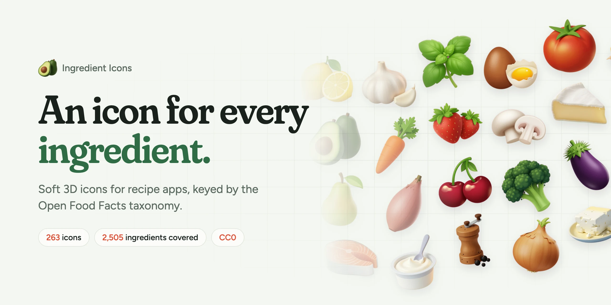
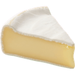
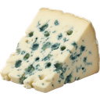
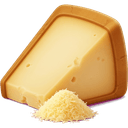

<p align="center">
  <a href="https://ingredient-icons.vercel.app">
    
  </a>
</p>

<p align="center">
  <b>309 soft 3D icons for recipe apps, one for every ingredient family, keyed by an open ingredient catalog.</b><br>
  Shallots, crème fraîche, salt and pepper each get their own, and anything else borrows its closest parent's.
</p>

<p align="center">
  <a href="https://ingredient-icons.vercel.app"><b>Website</b></a> ·
  <a href="https://ingredient-icons.vercel.app/docs">Docs</a> ·
  <a href="https://ingredient-icons.vercel.app/icons">Browse the icons</a> ·
  <a href="https://github.com/EBf-Studio/ingredient-icons">GitHub</a> ·
  <a href="https://github.com/EBf-Studio/ingredient-icons/issues/new">Request an icon</a>
</p>

## Emojis run out at the onion

There is no emoji for a shallot, and 🧂 has to stand in for salt and pepper. A recipe shows each ingredient as what it is.

| Emoji | Ingredient Icons |
| :---: | --- |
| 🧅 |      |
| 🧂 |      |
| 🧀 |      |

## Quick start

```sh
npm install @ingredient-icons/core
```

Pass the catalog id of an ingredient, get back an image URL:

```tsx
import { iconUrl } from "@ingredient-icons/core"

export function Ingredient({ id, quantity, name }) {
  return (
    <li>
      
      {quantity} {name}
    </li>
  )
}

<Ingredient id="cherry-tomato" quantity="250 g" name="cherry tomatoes" />
```

URLs point to the exact release you installed on jsDelivr, so icons never change under you. Pass `baseUrl` to serve them from your own CDN or app bundle. Works in React, React Native, Node, Bun, Deno and anything else that shows images, with TypeScript types included.

```ts
import { GENERIC_ID, iconUrl } from "@ingredient-icons/core"

iconUrl("shallot", { size: 256 })
// https://cdn.jsdelivr.net/npm/@ingredient-icons/core@<version>/icons/webp/256/shallot.webp

iconUrl("garam-masala")  // undefined: no icon of its own, see below for its family's
iconUrl("unicorn-steak") ?? iconUrl(GENERIC_ID)  // the generic icon, a cluster of fresh ingredients
```

`GENERIC_ID` (`"generic"`) is a reserved id, not a catalog one: the icon for an ingredient nothing places at all.

[React](https://ingredient-icons.vercel.app/docs/guides/react) · [React Native](https://ingredient-icons.vercel.app/docs/guides/react-native) · [Next.js](https://ingredient-icons.vercel.app/docs/guides/nextjs) · [Self-hosting](https://ingredient-icons.vercel.app/docs/guides/self-hosting) · [Without npm](https://ingredient-icons.vercel.app/docs/guides/without-npm) · [API reference](https://ingredient-icons.vercel.app/docs/reference/api)

## No icon of its own? It borrows its parent's

Ids come from an ingredient catalog of about 1,260 catalog ingredients under 32 families, each with exactly one parent: sea salt is a salt, and salt falls under the salts family. Every family has an icon, so walking up the parents always ends on one: that's how **309 icons cover all 1,259 catalog entries**. The catalog ships with every release as `catalog.json` (ids, parents, families, and names in six languages).

<p>
  <code>sea-salt</code> →  <code>salt</code><br>
  <code>crushed-tomatoes</code> →  <code>tomato</code><br>
  <code>garam-masala</code> →  <code>spice-blends</code>
</p>

```ts
import snapshot from "@ingredient-icons/core/catalog.json"
import { GENERIC_ID, iconUrl, type Catalog } from "@ingredient-icons/core"

const catalog: Catalog = snapshot as Catalog

/** Its own icon, else its nearest ancestor's, its family's last, else the generic one. */
function iconFor(id: string): string {
  for (let at: string | undefined = id; at; at = catalog.entries[at]?.parent) {
    const url = iconUrl(at)
    if (url) return url
  }
  return iconUrl(GENERIC_ID)!
}
```

Try it with any ingredient [on the website](https://ingredient-icons.vercel.app).

## What's in the package

Transparent WebP in 64, 128 and 256 px, under `icons/webp/{size}/`. 128 px covers a 40 pt icon on a 3× screen; 256 px covers almost everything else. Names come from `catalog.json`, in French, English, Spanish, Italian, German and Portuguese.

`catalog.json` is the snapshot of the ingredient catalog the ids come from (`CATALOG_RELEASE` names its release): every catalog ingredient and family with its parent, its family, and its names and synonyms per language. Import it as `@ingredient-icons/core/catalog.json`, typed with `Catalog`.

To serve the files yourself, expose the package's `icons/` folder and pass `{ baseUrl }`: see the [self-hosting guide](https://ingredient-icons.vercel.app/docs/guides/self-hosting). PNG up to 512 px and `manifest.json` are in the [GitHub repository](https://github.com/EBf-Studio/ingredient-icons).

## Missing an ingredient?

New icons ship in batches. [Open an issue](https://github.com/EBf-Studio/ingredient-icons/issues/new) with the catalog id (`yuzu`) or the name of the ingredient, and it goes on the list. An ingredient the catalog lacks is added to it first.

## Licenses

- Icons: [CC0 1.0](https://github.com/EBf-Studio/ingredient-icons/blob/main/LICENSE-ICONS). Created with Grok. No attribution required, a link back is appreciated.
- Catalog snapshot (`catalog.json`): [CC0 1.0](https://github.com/EBf-Studio/ingredient-icons/blob/main/LICENSE-ICONS). Names from [Wikidata](https://www.wikidata.org) (CC0) or written by Marmalade.
- Code: [MIT](https://github.com/EBf-Studio/ingredient-icons/blob/main/LICENSE).

<p align="center">
  <br>
  <br>
  Made by <a href="https://try-marmalade.com">Marmalade</a>
</p>
